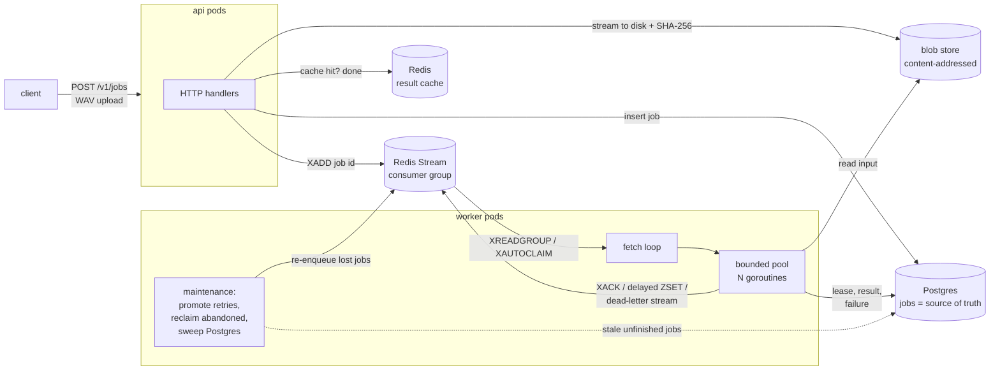

# audio-jobs

A background-job system for processing uploaded audio recordings, written in
Go on Postgres and Redis Streams. The API accepts a recording and returns
immediately. Workers analyse it: duration, levels, a waveform for the player,
and silence and speech segments. Every job finishes even when workers are
killed mid-job or Redis loses its data.

The point of the project is less the audio than the job system around it:
at-least-once delivery, retries with backoff, a dead-letter queue, lease
fencing, recovery from a Redis wipe, graceful shutdown on Kubernetes, and
measurements for each claim.

| Claim | Evidence (generated by scripts in this repo) |
|---|---|
| Every accepted job finishes despite crashes | [Chaos test](docs/results/chaos.md): 18 workers SIGKILLed mid-job, Redis restarted without persistence, 5% injected failures, 1000 / 1000 jobs succeeded with correct results |
| The hot path was profiled and fixed | [Analyzer benchmark](docs/results/audio-benchmark.md): about 20x faster and 3,000x less memory per recording, after pprof showed `math.Pow` at 61% of CPU |
| The fix shows up end to end | [Load test](docs/results/load-test.md): 162 → 532 jobs/s, p95 latency 249 → 15 ms, peak worker memory 878 → 94 MB on identical inputs |
| Queries are designed for a table with history | [Query benchmark](docs/results/query-optimization.md) on 1M rows: tenant listing 58.8 → 0.014 ms, sweeper 34.9 → 0.11 ms; the indexes' write cost measured too (+42% on the job lifecycle) |
| How I work through a hard bug | [Case study](docs/CASE_STUDY.md): a chaos test that passed for the wrong reason, and the two defects it was hiding |

All measurements were taken on one machine (Apple M4), against local Redis and
Postgres. They are benchmarks with synthetic recordings, not production
traffic.

## Architecture



**Submit.** The API streams the upload to a content-addressed blob store,
hashing as it goes, and rejects anything that is not 16-bit PCM WAV. If the
result for that hash is already cached, the job is created as succeeded
without touching the queue. Otherwise it inserts a `queued` row and adds the
job ID to the stream. An `Idempotency-Key` header makes resubmission safe
(unique per tenant).

**Process.** Each worker reads only as many deliveries as it has free
slots. For each one, `Start` takes a lease in Postgres. A job that is
already terminal is acknowledged; one held by another live attempt is left
pending. While the job runs, a heartbeat extends both the Postgres lease and
the Redis delivery. Results go to Postgres through a lease-checked update, so
an attempt that lost its lease cannot overwrite a newer one.

**Fail.** Failures are split in two:

- *Permanent* (corrupt input): the job is dead immediately and goes to the
  dead-letter stream.
- *Transient*: retried after `base × 2^(attempt−1)` with jitter, via a sorted
  set that a Lua script promotes back into the stream atomically. After
  `MAX_ATTEMPTS` the job is dead.

**Recover.**

- A worker that dies leaves its deliveries pending; others take them with
  `XAUTOCLAIM` after the visibility timeout.
- If Redis loses everything, the sweeper finds unfinished jobs in Postgres
  through a partial index and enqueues them again. Workers also re-create the
  consumer group when Redis answers `NOGROUP`.
- Duplicate deliveries are harmless because `Start` decides who holds the
  lease.

**Shut down.** On SIGTERM a worker stops fetching and drains in-flight jobs
for `SHUTDOWN_GRACE`, which stays below the pod's
`terminationGracePeriodSeconds`. Whatever is left is reclaimed elsewhere.

## Design decisions and trade-offs

- **Postgres as the source of truth, Redis as transport.** Redis Streams
  gives cheap fan-out, consumer groups and a pending-entries list. Postgres
  gives durable state, constraints and queryable history. Keeping state out of
  Redis means losing Redis costs latency, not jobs; the chaos test shows it.
  The cost is two systems to run, and a dual write on submit, covered by the
  sweeper rather than by a transactional outbox.
- **At-least-once, with idempotent effects.** Exactly-once delivery is not
  available. Instead, every state transition is a single conditional
  `UPDATE` (fenced by the lease token), and analysis results depend only on
  the input. The cost is occasional duplicate work, which the `Busy` outcome
  keeps rare.
- **Keyset pagination, not OFFSET.** At page 101, OFFSET reads 5,089 buffers;
  the keyset query reads 54 (0.911 vs 0.020 ms).
- **Two indexes, not three.** Listing a tenant's jobs by a rare status still
  scans about 11k buffers (1.37 ms). A four-column index would make that
  query instant, but `status` changes 2–3 times per job, and the existing
  indexes already add 42% to the write path. I left it out until the query
  matters.
- **A partial index for the sweeper.** `WHERE status IN ('queued','running','failed')`
  covers about 1% of the table, so the sweeper costs the same at 1M rows as
  at 1k.
- **Stream, don't load.** The analyzer runs in constant memory, so worker
  memory limits do not depend on recording length (256 Mi in the
  manifests).
- **Content addressing.** Identical uploads are stored once, and the hash is
  the cache key, versioned by the algorithm (`audio.Version`).
- **Not built:** object storage (the blob store is a shared volume behind
  three methods), authentication (tenants are a header), multi-region, and a
  transactional outbox.

## Run it

Requirements: Go 1.26+, Redis, PostgreSQL. On macOS:
`brew install go redis postgresql@17`.

```bash
make dev-up        # Redis on :6390 and Postgres on :5440, data in .local/
make test          # unit + integration tests with the race detector
make run           # API on :8088 + 4 worker processes
```

Then try it:

```bash
go run ./cmd/loadgen -api http://127.0.0.1:8088 -jobs 100 -duration-ms 20000
```

Reproduce the numbers above:

```bash
make bench-audio   # analyzer: streaming vs reference
make load          # end-to-end load test (3 runs)
make chaos         # kills, injected failures, Redis restart
go run ./cmd/querybench   # 1M-row query benchmark (creates and drops a scratch DB)
make k8s-validate  # kubeconform on deploy/k8s
```

## Tests

`go test -race ./...` runs 21 tests: 7 analyzer, 1 queue unit, and 13
integration tests against real Redis and Postgres. Each integration test gets
its own database and key prefix, and they skip if the services are not
running. The integration tests cover:

- submit, process, and the cache hit;
- idempotency keys scoped per tenant;
- rejected uploads: not WAV, too large, no tenant;
- transient failures retried with backoff;
- exhausted retries going to the dead-letter stream;
- corrupt input failing permanently without retries;
- a crashed worker's delivery reclaimed by another worker;
- a stale lease unable to overwrite a newer attempt, and a live lease unable
  to be taken over;
- the sweeper recovering jobs after Redis loses its data;
- a worker recovering after the consumer group is deleted under it;
- graceful drain on shutdown;
- keyset pagination;
- consistent timestamps on cached jobs.

The analyzer tests require the streaming implementation to match the
reference implementation exactly on four kinds of recording.

## Deploy

[`deploy/k8s`](deploy/k8s) has the manifests, validated with kubeconform in
strict mode:

- separate API and worker Deployments with probes, PodDisruptionBudgets and a
  non-root, read-only-root security context;
- workers named after their pod (each is its own stream consumer), with
  `GOMEMLIMIT` taken from the memory limit and a termination grace period
  longer than the drain window;
- a migration Job (the migrator takes an advisory lock);
- a CPU-based HPA, plus an optional KEDA `ScaledObject` that scales on stream
  lag, the better signal for a queue.

The `Dockerfile` builds one distroless image containing all the binaries.
Prometheus metrics are on `/metrics`: submissions, finished jobs by status,
attempt and end-to-end latency, retries, reclaims, sweeps, lost leases,
cache hits, queue depth by state, and in-flight jobs.

**Verified in CI:** every push builds the image and runs the full test suite
with the race detector against Postgres and Redis service containers, and
validates the manifests with kubeconform
([workflow](https://github.com/imperiobaal69-web/audio-jobs/actions/workflows/ci.yml)).
**Not verified here:** the manifests have not been applied to a cluster from
this repository.

## Layout

```
cmd/api, cmd/worker, cmd/migrate   service binaries
cmd/loadgen                        load generator (throughput, latency, result integrity)
cmd/querybench                     1M-row EXPLAIN ANALYZE benchmark
internal/audio                     WAV parsing, streaming analyzer, reference analyzer, synthetic speech
internal/queue                     Redis Streams queue: reclaim, heartbeat, delayed retries, dead letters
internal/store                     Postgres jobs, migrations, lease-fenced transitions, sweeper query
internal/worker                    worker loop, pool, maintenance loops, graceful drain
internal/api                       HTTP handlers
internal/e2e                       integration tests
deploy/k8s                         Kubernetes manifests
scripts/                           dev environment, load test, chaos test, benchmarks, validation
docs/                              case study and generated results
```

## License

MIT
